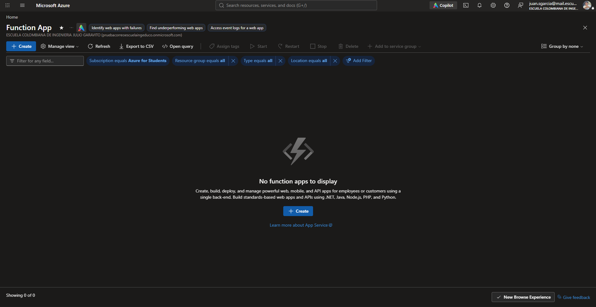
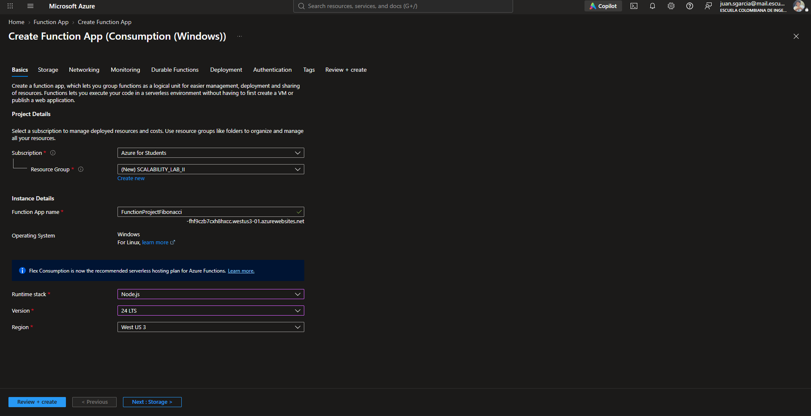
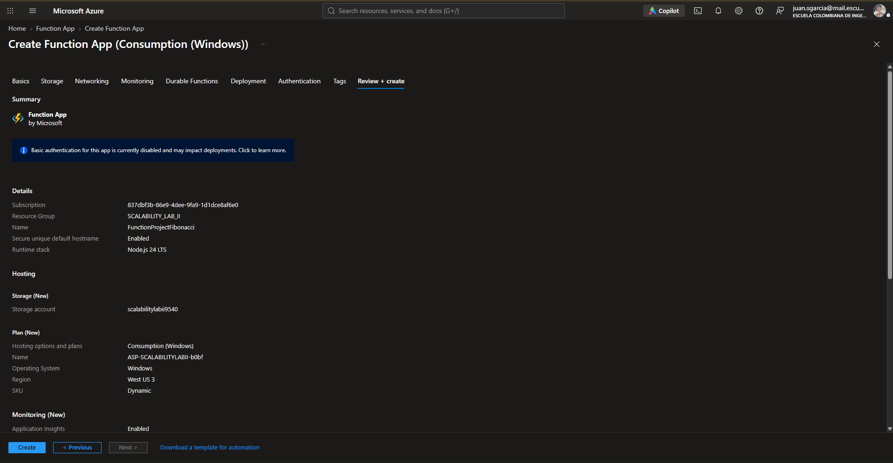
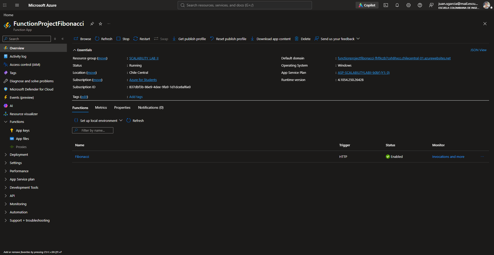
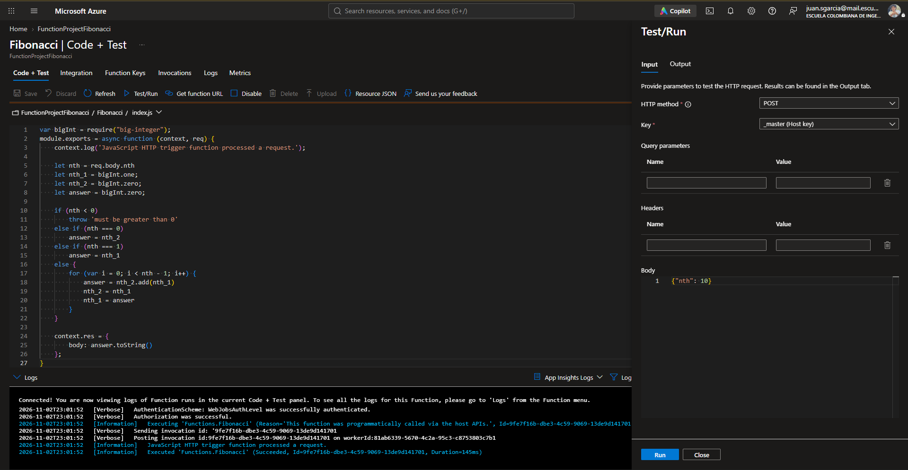
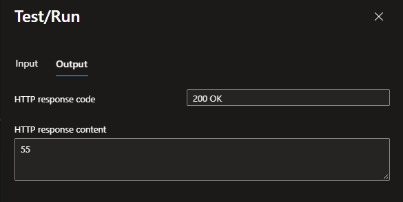
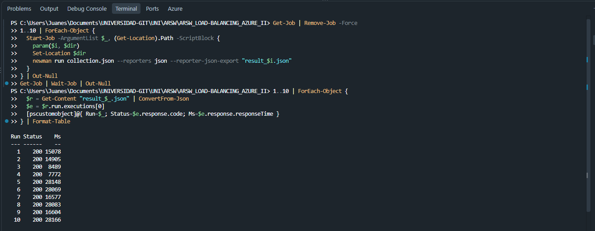
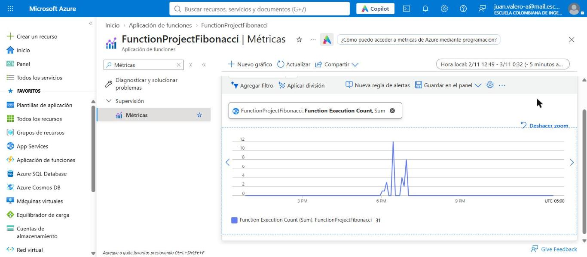
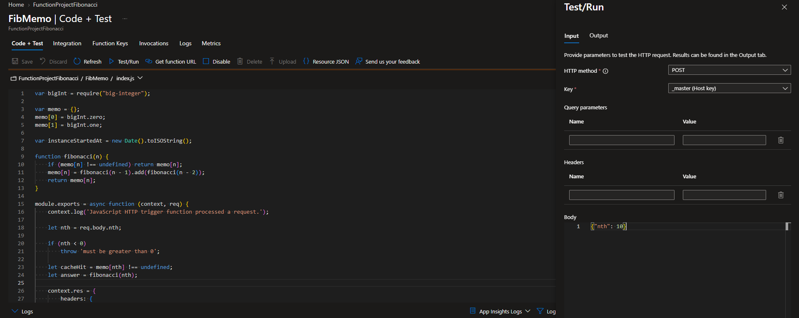

# Informe – Escalabilidad Serverless con Azure Functions

**Escuela Colombiana de Ingeniería – Arquitecturas de Software (ARSW)**

[← Volver al README](README.md)

---

## Contenido

1. [Escenario de calidad](#1-escenario-de-calidad)
2. [Creación de la Function App](#2-creación-de-la-function-app)
3. [Despliegue y prueba de la función Fibonacci](#3-despliegue-y-prueba-de-la-función-fibonacci)
4. [Prueba de carga con Newman (10 peticiones concurrentes)](#4-prueba-de-carga-con-newman-10-peticiones-concurrentes)
5. [Fibonacci recursivo con memoization (FibMemo)](#5-fibonacci-recursivo-con-memoization-fibmemo)
6. [Respuestas a las preguntas](#6-respuestas-a-las-preguntas)
7. [Conclusiones](#7-conclusiones)
8. [Evidencias y estructura del repositorio](#8-evidencias-y-estructura-del-repositorio)

---

## 1. Escenario de calidad

> **Escalabilidad:** cuando un conjunto de usuarios consulta un enésimo número (superior a 1.000.000) de la secuencia de Fibonacci de forma concurrente y el sistema se encuentra bajo condiciones normales de operación, todas las peticiones deben ser respondidas y el consumo de CPU del sistema no puede superar el 70 %.

En este laboratorio el cálculo se lleva a un modelo **serverless**: en lugar de administrar máquinas virtuales o un App Service Plan dedicado, la lógica se despliega como una **Azure Function** con disparador HTTP y es la plataforma la que decide cuántas instancias levantar según la demanda.

---

## 2. Creación de la Function App

Se parte del listado de Function Apps vacío en la suscripción *Azure for Students*.



Se crea la Function App con la siguiente configuración:

| Parámetro | Valor |
|---|---|
| Suscripción | Azure for Students |
| Grupo de recursos | `SCALABILITY_LAB_II` (nuevo) |
| Nombre | `FunctionProjectFibonacci` |
| Plan de hospedaje | Consumption (Windows) – SKU *Dynamic* |
| Runtime stack | Node.js 24 LTS |
| Storage account | `scalabilitylabii9540` (nuevo) |
| Application Insights | Habilitado |





> En la captura del asistente aparece la región *West US 3*; la Function App que finalmente quedó desplegada y sobre la que se hicieron todas las pruebas está en **Chile Central** (ver captura siguiente y la URL usada en `collection.json`).

Una vez creada, la Function App queda en estado **Running**, asociada al plan `ASP-SCALABILITYLABII-b0bf (Y1)` y con runtime de Functions `4.x`:



---

## 3. Despliegue y prueba de la función Fibonacci

### 3.1 Despliegue

El despliegue se hizo desde Visual Studio Code con la extensión **Azure Functions**. La configuración del workspace (`.vscode/settings.json`) indica:

- `azureFunctions.deploySubpath: FunctionProject` → se despliega solo la carpeta del proyecto.
- `azureFunctions.projectRuntime: ~4` y `projectLanguage: JavaScript`.
- `preDeployTask: npm prune` y `postDeployTask: npm install` → las dependencias (`big-integer`) se instalan en Azure.

En `FunctionProject/host.json` se actualizó el *extension bundle* a `[4.*, 5.0.0)` para que fuese compatible con el runtime 4.

### 3.2 Código de la función iterativa

`FunctionProject/Fibonacci/index.js` calcula F(n) de forma **iterativa** con `big-integer`, de modo que la complejidad es O(n) en tiempo y O(1) en memoria (más el tamaño del número):

```js
for (var i = 0; i < nth - 1; i++) {
    answer = nth_2.add(nth_1)
    nth_2 = nth_1
    nth_1 = answer
}
```

La función recibe un `POST` con cuerpo `{"nth": <n>}` y tiene `authLevel: anonymous`.

### 3.3 Prueba desde el portal

Desde *Code + Test → Test/Run* se envió `{"nth": 10}` por `POST`. En los logs se ve la invocación exitosa (`Succeeded`, ~145 ms):



La respuesta fue `200 OK` con contenido **55**, que es F(10):



---

## 4. Prueba de carga con Newman (10 peticiones concurrentes)

### 4.1 Colección

Se exportó la colección de Postman a [`collection.json`](collection.json). Contiene una única petición `POST` a:

```
https://functionprojectfibonacci-fhf9czb7cxh8hxcc.chilecentral-01.azurewebsites.net/api/Fibonacci
Body: {"nth": 1000000}
```

### 4.2 Ejecución concurrente

Para lanzar 10 ejecuciones en paralelo se usó PowerShell con `Start-Job`, de modo que cada job ejecuta su propio `newman run` y exporta su resultado en JSON. El procedimiento quedó guardado en el script reutilizable [`scripts/newman_concurrente.ps1`](scripts/newman_concurrente.ps1), que permite cambiar el número de peticiones con `-Peticiones` y además imprime el promedio, el mínimo y el máximo:

```powershell
powershell -ExecutionPolicy Bypass -File scripts\newman_concurrente.ps1 -Peticiones 10
```

Esta es la versión que se ejecutó directamente en la terminal durante el laboratorio:

```powershell
Get-Job | Remove-Job -Force
1..10 | ForEach-Object {
  Start-Job -ArgumentList $_, (Get-Location).Path -ScriptBlock {
    param($i, $dir)
    Set-Location $dir
    newman run collection.json --reporters json --reporter-json-export "result_$i.json"
  }
} | Out-Null
Get-Job | Wait-Job | Out-Null

1..10 | ForEach-Object {
  $r = Get-Content "result_$_.json" | ConvertFrom-Json
  $e = $r.run.executions[0]
  [pscustomobject]@{ Run=$_; Status=$e.response.code; Ms=$e.response.responseTime }
} | Format-Table
```



Los reportes completos de Newman están en la carpeta [`first_newman/`](first_newman/), uno por ejecución (unos 38 MB en total). Cada archivo pesa unos 4 MB porque incluye el cuerpo completo de la respuesta, es decir, los 208 988 dígitos de F(1.000.000). Cada uno contiene la petición enviada, los tiempos (`run.timings`), el código HTTP y la respuesta:

| Ejecución | Reporte |
|:-:|---|
| 1 | [`first_newman/result_1.json`](first_newman/result_1.json) |
| 2 | [`first_newman/result_2.json`](first_newman/result_2.json) |
| 3 | [`first_newman/result_3.json`](first_newman/result_3.json) |
| 4 | [`first_newman/result_4.json`](first_newman/result_4.json) |
| 5 | [`first_newman/result_5.json`](first_newman/result_5.json) |
| 6 | [`first_newman/result_6.json`](first_newman/result_6.json) |
| 7 | [`first_newman/result_7.json`](first_newman/result_7.json) |
| 8 | [`first_newman/result_8.json`](first_newman/result_8.json) |
| 9 | [`first_newman/result_9.json`](first_newman/result_9.json) |
| 10 | [`first_newman/result_10.json`](first_newman/result_10.json) |

> GitHub no muestra en el navegador archivos tan grandes; para verlos se puede usar el botón **Raw** o **Download**.

### 4.3 Resultados

| Ejecución | Código HTTP | Tiempo de respuesta (ms) | Tamaño de respuesta (bytes) |
|:-:|:-:|--:|--:|
| 1 | 200 | 15 078 | 208 988 |
| 2 | 200 | 14 905 | 208 988 |
| 3 | 200 | 8 489 | 208 988 |
| 4 | 200 | 7 772 | 208 988 |
| 5 | 200 | 28 148 | 208 988 |
| 6 | 200 | 28 069 | 208 988 |
| 7 | 200 | 16 577 | 208 988 |
| 8 | 200 | 28 083 | 208 988 |
| 9 | 200 | 16 604 | 208 988 |
| 10 | 200 | 28 166 | 208 988 |

| Métrica | Valor |
|---|---|
| Peticiones exitosas | **10 / 10 (100 %)** |
| Peticiones fallidas | 0 |
| Tiempo promedio | **19 189 ms** (~19,2 s) |
| Mediana | 16 591 ms |
| Mínimo | 7 772 ms |
| Máximo | 28 166 ms |
| Duración total de la prueba (inicio de la 1.ª → fin de la última) | ~49 s |

El tamaño de la respuesta (208 988 bytes) coincide con el número de dígitos de F(1.000.000), lo que confirma que todas las peticiones devolvieron el resultado correcto y completo.

### 4.4 Análisis

- **Se cumple la primera parte del escenario de calidad:** todas las peticiones fueron respondidas con `200 OK`, ninguna dio timeout ni error.
- **Los tiempos crecen con la concurrencia.** Las tres primeras peticiones arrancaron casi al mismo tiempo y tardaron entre 8,5 s y 15 s. Las seis que arrancaron unos 20 s después (cuando aún había otras en curso) tardaron entre 16,6 s y 28,2 s, y terminaron en dos grupos (≈ 16,6 s y ≈ 28,1 s).
- **Causa probable:** el cálculo de F(1.000.000) es *CPU-bound* y en Node.js se ejecuta de forma síncrona dentro del *event loop*. Mientras un worker calcula, no atiende otra petición, así que las peticiones que caen en la misma instancia/worker quedan en cola. En el plan Consumption el escalado horizontal (*scale-out*) no es inmediato: el *scale controller* necesita tiempo para detectar la carga y asignar nuevas instancias, y cada instancia nueva paga además un *cold start*.
- **Nota sobre la concurrencia real:** `Start-Job` lanza un proceso de PowerShell por job, así que las 10 peticiones no salieron exactamente en el mismo instante (las marcas de inicio de los reportes se reparten en ~21 s). Aun así, en el pico hubo hasta 7 peticiones en vuelo a la vez.
- **Sobre el 70 % de CPU:** en el plan Consumption no se administra ni se dimensiona la CPU de la instancia; esa restricción la gestiona la plataforma mediante el escalado. Lo que sí se observa es el costo en latencia: el sistema es *elástico* pero no responde en tiempos bajos frente a cargas CPU-intensivas repentinas.

**Métricas en Azure Monitor.** En el blade *Métricas* de la Function App (espacio de nombres *App Service métricas estándar*) el plan Consumption (Y1) **no expone ninguna métrica de porcentaje de CPU** (el filtro "CPU" no devuelve resultados), y *Automatic Scaling Instance Count* no registra datos en este plan. Por eso se usó *Function Execution Count* (Sum) en la ventana del 2 de noviembre, que muestra la actividad de las pruebas entre las 6 PM y las 7 PM (hora local, UTC-05:00), con un total de 31 ejecuciones en el periodo:



Esta captura demuestra cuándo y cuánta carga recibió la función, pero no permite verificar directamente el umbral del 70 % de CPU: en Consumption esa medición no está disponible para el usuario y el control lo hace la propia plataforma al escalar.

---

## 5. Fibonacci recursivo con memoization (FibMemo)

### 5.1 Implementación

Se creó una nueva función, `FunctionProject/FibMemo/index.js`, que resuelve el problema de forma **recursiva con memoization**. El diccionario `memo` se declara **fuera** del handler, por lo que vive mientras viva el proceso de la instancia:

```js
var memo = {};
memo[0] = bigInt.zero;
memo[1] = bigInt.one;

var instanceStartedAt = new Date().toISOString();

function fibonacci(n) {
    if (memo[n] !== undefined) return memo[n];
    memo[n] = fibonacci(n - 1).add(fibonacci(n - 2));
    return memo[n];
}
```

Para poder observar el comportamiento de la caché, la respuesta incluye tres cabeceras:

| Cabecera | Significado |
|---|---|
| `x-cache-hit` | `true` si el valor pedido ya estaba en `memo` antes de la petición |
| `x-cache-size` | número de entradas en `memo` después de atender la petición |
| `x-instance-started` | momento (UTC) en que se cargó el módulo, es decir, en que arrancó la instancia |



### 5.2 Procedimiento

1. **Fase 1 – antes:** se pidió F(1000), F(3000) y F(5000), y luego los mismos tres valores otra vez.
2. Se dejó la función **sin tráfico durante ~30 minutos** (más de los 5 minutos que pide el enunciado).
3. **Fase 2 – después:** se repitió exactamente la misma secuencia.

Las peticiones y el registro se automatizaron con [`scripts/prueba_fibmemo.ps1`](scripts/prueba_fibmemo.ps1), que pide cada valor dos veces, lee las cabeceras de caché y guarda los resultados en CSV:

```powershell
powershell -ExecutionPolicy Bypass -File scripts\prueba_fibmemo.ps1 -Archivo fase1_antes.csv
# ... esperar al menos 5 minutos sin tráfico ...
powershell -ExecutionPolicy Bypass -File scripts\prueba_fibmemo.ps1 -Archivo fase2_despues.csv
```

Los datos crudos están en [`fase1_antes.csv`](fase1_antes.csv) y [`fase2_despues.csv`](fase2_despues.csv). La columna *Hora* es hora local (UTC−5) y *Instancia* es la cabecera `x-instance-started` (UTC).

**Fase 1 – antes del periodo de inactividad**

| Hora | n | Cache hit | Tamaño caché | ms | Instancia iniciada |
|---|--:|:-:|--:|--:|---|
| 18:56:13 | 1000 | false | 1001 | 849 | 2026-11-02T23:52:55Z |
| 18:56:14 | 3000 | false | 3001 | 342 | 2026-11-02T23:52:55Z |
| 18:56:14 | 5000 | false | 5001 | 329 | 2026-11-02T23:52:55Z |
| 18:56:15 | 1000 | **true** | 5001 | 354 | 2026-11-02T23:52:55Z |
| 18:56:15 | 3000 | **true** | 5001 | 535 | 2026-11-02T23:52:55Z |
| 18:56:16 | 5000 | **true** | 5001 | 333 | 2026-11-02T23:52:55Z |

**Fase 2 – después de ~30 minutos sin tráfico**

| Hora | n | Cache hit | Tamaño caché | ms | Instancia iniciada |
|---|--:|:-:|--:|--:|---|
| 19:26:40 | 1000 | **false** | **1001** | **1127** | **2026-11-03T00:26:41Z** |
| 19:26:41 | 3000 | false | 3001 | 458 | 2026-11-03T00:26:41Z |
| 19:26:42 | 5000 | false | 5001 | 402 | 2026-11-03T00:26:41Z |
| 19:26:42 | 1000 | true | 5001 | 387 | 2026-11-03T00:26:41Z |
| 19:26:42 | 3000 | true | 5001 | 406 | 2026-11-03T00:26:41Z |
| 19:26:43 | 5000 | true | 5001 | 393 | 2026-11-03T00:26:41Z |

### 5.3 ¿Cuál es el comportamiento?

- **Dentro de una misma ventana activa la memoization funciona:** en la fase 1, la segunda vez que se pide cada valor `x-cache-hit` es `true` y la caché ya no crece (se queda en 5001 entradas).
- **Después de la inactividad la caché se pierde por completo.** En la fase 2 la primera petición de F(1000) vuelve a ser *miss* y la caché arranca de nuevo con 1001 entradas, aunque ese valor ya se había calculado media hora antes.
- **Hay una instancia nueva.** La cabecera `x-instance-started` cambió de `23:52:55Z` a `00:26:41Z`, prácticamente el mismo instante de la primera petición de la fase 2 (19:26:40 hora local = 00:26:40Z). Es decir, la petición **despertó** una instancia nueva: Azure había reciclado la anterior por inactividad (*scale to zero*).
- **Se nota el cold start:** la primera petición de la fase 2 tardó **1127 ms**, frente a ~330–460 ms del resto, porque incluyó arrancar la instancia, cargar el runtime de Node.js y el módulo `big-integer`.
- La diferencia entre *hit* y *miss* en el resto de las peticiones es pequeña porque para n ≤ 5000 el cálculo es muy rápido y el tiempo lo domina la latencia de red y la serialización.

### 5.4 Limitación adicional: profundidad de la recursión

Con la recursión, calcular F(n) en frío necesita una pila de llamadas de profundidad ~n. Para el escenario de calidad (n ≥ 1.000.000) esto **no funciona**: se probó localmente en Node.js el mismo patrón recursivo con n = 1.000.000 y falla con:

```
RangeError: Maximum call stack size exceeded
```

Por eso las pruebas de FibMemo se hicieron con valores de hasta 5000. La versión iterativa, en cambio, sí calcula F(1.000.000) sin problema.

---

## 6. Respuestas a las preguntas

### ¿Qué es un Azure Function?

Es el servicio de cómputo *serverless* de Azure que permite ejecutar fragmentos de código (funciones) en respuesta a un **evento** o **disparador** (*trigger*): una petición HTTP, un temporizador, un mensaje en una cola, un archivo nuevo en Blob Storage, un evento de Event Grid, etc. Cada función declara en su `function.json` sus *bindings* de entrada y salida (en este laboratorio, `httpTrigger` de entrada y `http` de salida). Varias funciones se agrupan en una **Function App**, que es la unidad de despliegue, configuración y escalado.

### ¿Qué es serverless?

Es un modelo de ejecución en la nube en el que el desarrollador **no aprovisiona ni administra servidores**: el proveedor se encarga de la infraestructura, el sistema operativo, el parcheo, la disponibilidad y el **escalado automático** (incluido escalar a cero cuando no hay tráfico). El código se ejecuta bajo demanda y se **paga por uso real** (ejecuciones y recursos consumidos) en lugar de por capacidad reservada. Los servidores siguen existiendo; simplemente quedan abstraídos para quien desarrolla.

### ¿Qué es el runtime y qué implica seleccionarlo al momento de crear el Function App?

Hay dos conceptos relacionados:

- **Runtime stack / lenguaje** (aquí *Node.js 24 LTS*): el entorno de ejecución del lenguaje en el que se escriben las funciones. Determina qué lenguaje y versión se pueden usar, qué SDK y librerías están disponibles, en qué sistemas operativos y planes se puede hospedar, y hasta cuándo tiene soporte.
- **Versión del runtime de Azure Functions** (aquí `~4`, que en el portal aparece como `4.1054.x`): el *host* que carga las funciones, gestiona triggers y bindings y aplica `host.json`. Determina el modelo de programación y la versión de los *extension bundles* compatibles; por eso hubo que ajustar `host.json` a `[4.*, 5.0.0)`.

Elegirlo implica que todas las funciones de la Function App comparten ese lenguaje y versión; cambiarlo después puede requerir migrar código y dependencias, y una versión sin soporte deja de recibir parches de seguridad.

### ¿Por qué es necesario crear un Storage Account de la mano de un Function App?

Porque el runtime de Azure Functions depende de Azure Storage para operar:

- Guarda el **código y los paquetes** de la aplicación (en Consumption, en un *file share* de Azure Files).
- Almacena las **claves de función y de host** (`AzureWebJobsStorage`).
- Coordina las instancias: **locks** y *leases* para triggers como Timer o Blob, de modo que un evento no se procese dos veces cuando hay varias instancias.
- Mantiene el estado y las colas internas de **Durable Functions**.
- Sirve de respaldo para ciertos triggers y para registros internos.

Sin una Storage Account la Function App no puede arrancar ni escalar correctamente, porque las instancias no comparten disco local y necesitan un almacenamiento común.

### ¿Cuáles son los tipos de planes para un Function App? ¿En qué se diferencian? Ventajas y desventajas

| Plan | Cómo funciona | Ventajas | Desventajas |
|---|---|---|---|
| **Consumption (Y1)** – el usado en el laboratorio | Instancias asignadas dinámicamente según los eventos; escala a cero. | Pago por ejecución; *free grant* mensual; cero administración; escala automática. | *Cold starts*; tiempo máximo de ejecución limitado (5 min por defecto, 10 máx.); memoria limitada (~1,5 GB por instancia); sin integración completa con VNet. |
| **Flex Consumption** | Evolución serverless del Consumption: pago por uso con opción de instancias *siempre listas*, escalado por función. | Escalado más rápido y alto; integración con VNet; tamaño de memoria configurable; puede mitigar cold starts. | Solo Linux; más configuración; las instancias siempre listas tienen costo fijo. |
| **Premium (Elastic Premium EP1–EP3)** | Instancias *pre-calentadas* que escalan elásticamente según la carga. | Sin cold start; integración con VNet; ejecuciones más largas; instancias más potentes. | Se paga por núcleo/memoria de forma continua, aunque no haya tráfico; mínimo una instancia siempre encendida. |
| **Dedicated (App Service Plan)** | Las funciones corren en VMs de un App Service Plan, como una Web App. | Costo predecible; se aprovecha un plan existente; sin límite de duración (con *Always On*); control del tamaño de la VM. | No es realmente serverless: se paga la capacidad aunque esté ociosa; el escalado es manual o por reglas de autoescalado. |
| **Container Apps** | Funciones empaquetadas como contenedor sobre Azure Container Apps. | Contenedores personalizados; mezcla con microservicios; escalado basado en KEDA. | Más complejidad operativa; requiere manejar imágenes de contenedor. |

### ¿Por qué la memoization falla o no funciona de forma correcta?

1. **El estado vive en la memoria de una instancia efímera.** `memo` es una variable global del proceso de Node.js. En el plan Consumption, cuando la función pasa un tiempo sin tráfico, Azure **recicla la instancia** (escala a cero) y toda la memoria se pierde. Al volver a llamarla se crea una instancia nueva con la caché vacía. Es exactamente lo que muestran los datos: `x-instance-started` cambió y la caché volvió a empezar en 1001 entradas.
2. **La caché no se comparte entre instancias.** Si la plataforma escala a varias instancias, cada una tiene su propio `memo`; una petición puede caer en una instancia que nunca calculó ese valor. Además, los reinicios, despliegues o movimientos de host también borran la caché.
3. **La recursión no escala a n grandes.** Para n ≥ 1.000.000 la profundidad de la pila desborda el límite de V8 (`Maximum call stack size exceeded`). Además, guardar un millón de `BigInteger` enormes consumiría mucha más memoria de la que admite una instancia de Consumption.

Para que la memoization fuera útil en serverless, la caché debería ser **externa y compartida** (Azure Cache for Redis, Table/Blob Storage, Cosmos DB) y el algoritmo debería ser **iterativo** o *bottom-up*.

### ¿Cómo funciona el sistema de facturación de las Function App?

Depende del plan:

- **Consumption:** se paga por dos conceptos:
  - **Número de ejecuciones.**
  - **Recursos consumidos**, medidos en **GB-segundo**: la memoria usada (redondeada hacia arriba a múltiplos de 128 MB) multiplicada por la duración de la ejecución (con un mínimo de 100 ms).

  Cada mes incluye un *free grant* (del orden de 1 millón de ejecuciones y 400 000 GB-s gratis por suscripción); solo se cobra lo que supere eso. A esto se suma el costo de la **Storage Account** asociada y de **Application Insights**, que se facturan por separado. Si no hay tráfico, el costo de cómputo es prácticamente cero.
- **Flex Consumption:** pago por ejecución y GB-s según la memoria elegida, más un cargo fijo por las instancias *siempre listas* que se configuren.
- **Premium:** se paga por **vCPU-segundo y GB-segundo** de las instancias asignadas (incluida la mínima, siempre encendida), haya ejecuciones o no.
- **Dedicated:** se paga el precio del **App Service Plan** (por instancia y por hora) independientemente del uso de las funciones.

En este laboratorio, con unas pocas decenas de ejecuciones en el plan Consumption, el consumo de cómputo queda dentro del *free grant*.

---

## 7. Conclusiones

- Azure Functions en plan Consumption permitió desplegar el cálculo de Fibonacci **sin administrar infraestructura**, y la prueba de 10 peticiones concurrentes con n = 1.000.000 se completó con un **100 % de éxito**.
- El precio de esa simplicidad es la **latencia bajo carga CPU-intensiva**: los tiempos pasaron de ~8 s a ~28 s cuando hubo varias peticiones simultáneas, porque el escalado horizontal no es instantáneo y Node.js procesa el cálculo de forma síncrona.
- Las funciones deben diseñarse como **stateless**. Cualquier estado en memoria (como la caché de memoization) es oportunista: sirve mientras la instancia esté viva, pero se pierde tras la inactividad, los reinicios o el escalado, como se comprobó con el cambio de instancia y el *cold start* de 1127 ms.
- Para cargas sostenidas o sensibles a la latencia conviene evaluar los planes **Premium o Flex Consumption** (instancias pre-calentadas), usar una **caché distribuida** si se quiere reutilizar resultados y mantener el algoritmo **iterativo** para soportar valores de n muy grandes.

---

## 8. Evidencias y estructura del repositorio

```
ARSW_LOAD-BALANCING_AZURE_II/
├── README.md                     Enunciado del laboratorio (con enlace a este informe)
├── informe.md                    Este informe
├── collection.json               Colección de Postman usada por Newman (POST nth=1000000)
├── fase1_antes.csv               FibMemo: resultados antes del periodo de inactividad
├── fase2_despues.csv             FibMemo: resultados después de ~30 min sin tráfico
├── first_newman/                 10 reportes JSON de Newman (uno por petición concurrente)
├── scripts/
│   ├── newman_concurrente.ps1    Lanza N ejecuciones concurrentes de Newman
│   └── prueba_fibmemo.ps1        Prueba miss/hit de FibMemo y exporta a CSV
├── FunctionProject/              Proyecto de Azure Functions (Node.js, runtime ~4)
│   ├── Fibonacci/                Función iterativa (index.js + function.json)
│   ├── FibMemo/                  Función recursiva con memoization
│   ├── host.json                 Configuración del host (extension bundle 4.x)
│   └── package.json              Dependencia big-integer
├── images/
│   ├── part2/, part3/            Imágenes del enunciado
│   └── solLab/                   Capturas de la solución (1.png … 9.png)
└── .vscode/                      Configuración de despliegue con la extensión Azure Functions
```

| Requisito del enunciado | Dónde se evidencia |
|---|---|
| 1. Crear la Function App | [Sección 2](#2-creación-de-la-function-app), capturas 1–4 |
| 2. Instalar la extensión Azure Functions | [Sección 3.1](#31-despliegue), `.vscode/` |
| 3. Desplegar la función Fibonacci | [Sección 3.1](#31-despliegue), captura 4 |
| 4. Probar la función en el portal | [Sección 3.3](#33-prueba-desde-el-portal), capturas 5–6 |
| 5. Newman con 10 peticiones concurrentes e informe | [Sección 4](#4-prueba-de-carga-con-newman-10-peticiones-concurrentes), capturas 7 y 9 (métricas), `first_newman/`, `scripts/newman_concurrente.ps1` |
| 6. Fibonacci recursivo con memoization y prueba tras 5 min | [Sección 5](#5-fibonacci-recursivo-con-memoization-fibmemo), captura 8, CSV, `scripts/prueba_fibmemo.ps1` |
| Preguntas | [Sección 6](#6-respuestas-a-las-preguntas) |
| Informe | Este documento |

[← Volver al README](README.md)
